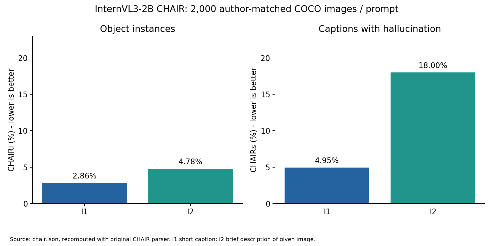
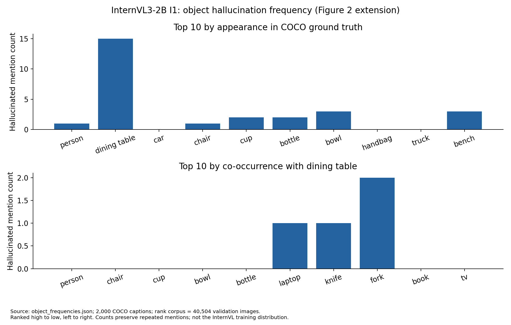
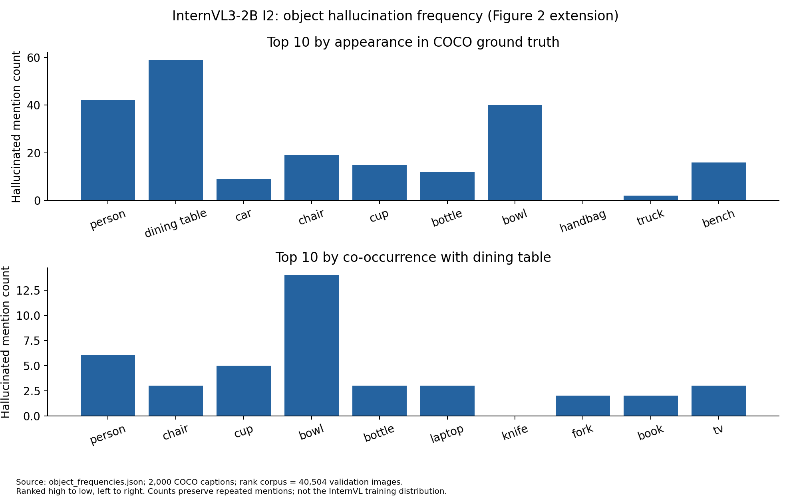
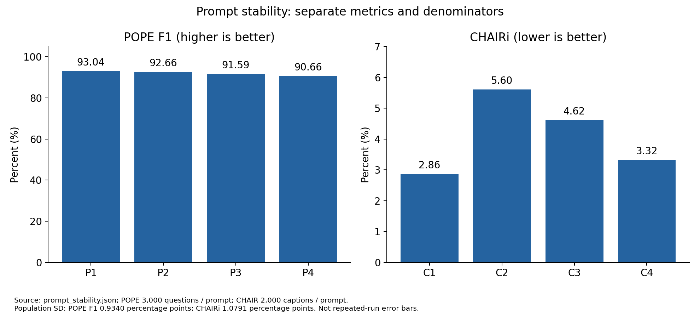
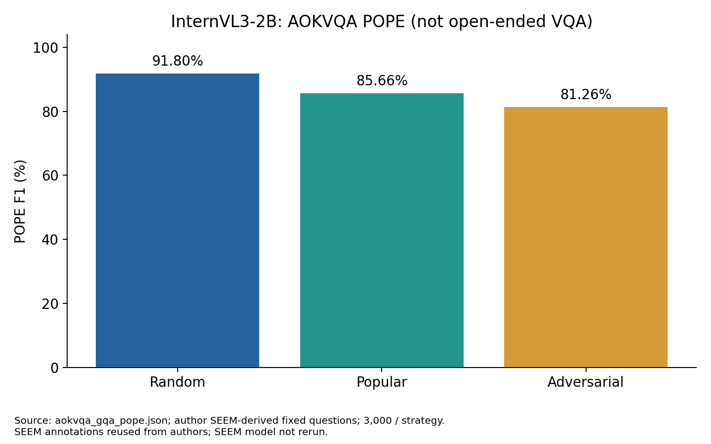
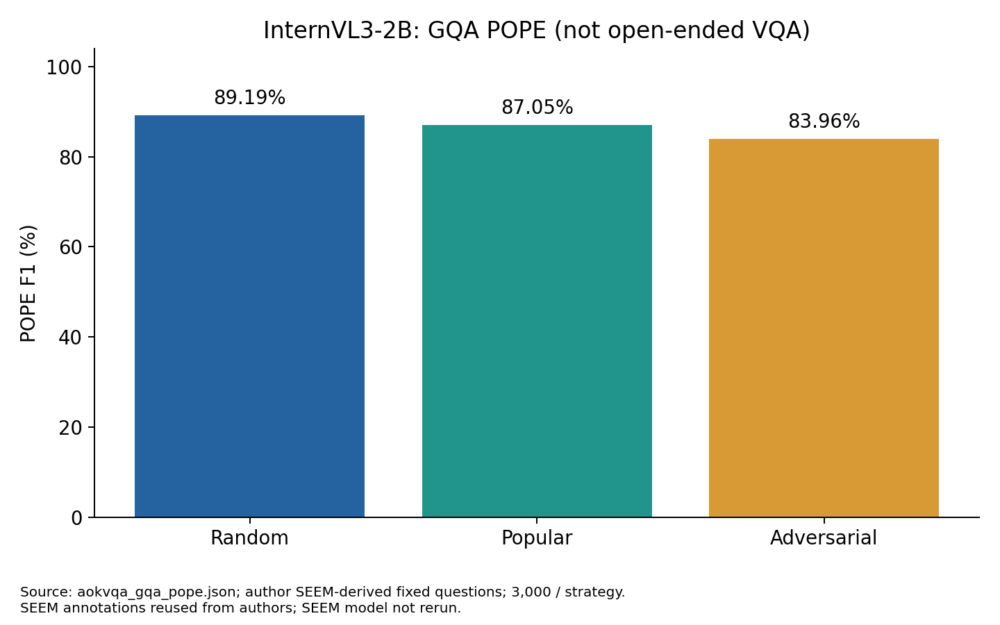

# 實際完成的實驗結果

整理日期：2026-10-19。來源為本機保存的正式 SQLite、JSONL、JSON/CSV 與評分紀錄；新查核程式只讀取來源，不重跑模型。以下百分比由未四捨五入資料產生。原論文值只出現在[歷史比較](REPRODUCTION_COMPARISON_zh-TW.md)。

## COCO POPE：對應 Table 3

| 策略 | 題數 | Accuracy % | Precision % | Recall % | F1 % | Yes % |
| --- | --- | --- | --- | --- | --- | --- |
| random | 3000 | 93.0333 | 92.9474 | 93.1333 | 93.0403 | 50.1000 |
| popular | 3000 | 86.2667 | 81.8875 | 93.1333 | 87.1491 | 56.8667 |
| adversarial | 3000 | 82.9000 | 77.3105 | 93.1333 | 84.4875 | 60.2333 |

| 策略 | TP | TN | FP | FN |
| --- | --- | --- | --- | --- |
| Random | 1397 | 1394 | 106 | 103 |
| Popular | 1397 | 1191 | 309 | 103 |
| Adversarial | 1397 | 1090 | 410 | 103 |

來源：[coco_pope.json](public_data/coco_pope.json)。各組 500 圖、3,000 題、正負各 1,500；原題與圖片雜湊已核對，Yes 為正類。負題難度增加時 FP 從 106 增至 410，正題相同，因此 Recall 保持 93.1333%。這是實際誤判增加，不是指標格式問題。

## CHAIR：對應 Table 1

| 提示 | 圖數 | CHAIRi % ↓ | CHAIRs % ↓ | 物件提及次數 | 幻覺次數 | 平均空白分詞長度 |
| --- | --- | --- | --- | --- | --- | --- |
| I1 | 2000 | 2.8634 | 4.9500 | 3632 | 104 | 16.289 |
| I2 | 2000 | 4.7814 | 18.0000 | 9516 | 455 | 83.6005 |

I1：`Generate a short caption of the image.`；I2：`Provide a brief description of the given image.`。兩者同為作者原 2,000 圖，總 4,000 描述。物件解析沿用 CHAIR 與 Pattern singularize，GT 採作者公布的 segmentation＋caption 物件。CHAIRi 為全部幻覺次數除以全部提及次數，不是逐圖 CHAIRi 平均。

I1 有 1 筆達長度上限、2 筆重複標記；I2 有 3、4 筆。主要分數沒有刪除這些輸出。僅保留正常 EOS 的敏感度分數見 [chair.json](public_data/chair.json)。較長的 I2 描述有更多物件提及及幻覺，但這不是對「長文字必然造成幻覺」的因果測試。

## 物件頻率：Figure 2、Table 2、Appendix B/C

排名依作者公開之 40,504 張 COCO 驗證圖的物件集合，並列頻率按標準物件名稱排序。這與分析原模型實際 instruction 訓練語料的頻率不同。計數單位是提及次數，保留重複；圖中的高次數不能直接解讀為該物件較高條件錯誤率。

原論文沒有清楚說明「無幻覺圖片」除以零如何處理，因此三種分母全部保留。下表先列 HRA@10/20/30；完整 HRC 的餐桌、椅子、汽車與 I1/I2 共 24 列見 [hra_hrc.json](public_data/hra_hrc.json)。

| 提示 | k | 全部圖 | 有幻覺圖 | 有幻覺圖平均 | 無幻覺補0後平均 | 全部提及合併比例 |
| --- | --- | --- | --- | --- | --- | --- |
| I1 | 10 | 2000 | 99 | 0.257576 | 0.012750 | 0.259615 |
| I1 | 20 | 2000 | 99 | 0.469697 | 0.023250 | 0.461538 |
| I1 | 30 | 2000 | 99 | 0.717172 | 0.035500 | 0.711538 |
| I2 | 10 | 2000 | 360 | 0.453638 | 0.081655 | 0.470330 |
| I2 | 20 | 2000 | 360 | 0.579332 | 0.104280 | 0.593407 |
| I2 | 30 | 2000 | 360 | 0.824140 | 0.148345 | 0.824176 |

這三欄都是 0–1 比例，不能任選一個當作精確重現原 Table 2。Appendix B 的累積比例屬合併提及比例：I1 前 30 類涵蓋 74/104=71.1538%；餐桌子集前 20 類涵蓋 10/17=58.8235%。見 [累積表](public_data/appendixB_cumulative.json)及[每物件次數](public_data/object_frequencies.json)。

## 提示穩定性：對應 Table 4

| 提示 | 題／圖數 | F1或CHAIRi %（各自解讀） |
| --- | --- | --- |
| P1 | 3000 | 93.0403 |
| P2 | 3000 | 92.6573 |
| P3 | 3000 | 91.5888 |
| P4 | 3000 | 90.6557 |
| C1 | 2000 | 2.8634 |
| C2 | 2000 | 5.6027 |
| C3 | 2000 | 4.6157 |
| C4 | 2000 | 3.3221 |

POPE P1–P4 F1 平均 91.9855%，母體標準差 0.9340 百分點；CHAIR C1–C4 平均 4.1010%，母體標準差 1.0791 百分點。這是四個固定提示間的離散程度，**不是多次隨機執行的信賴區間**，兩種指標也不是同一尺度的能力。C2 的 `of the image` 與 Table 1 I2 的 `of the given image` 不同。

## A-OKVQA／GQA 的 POPE：對應 Table 11、Appendix D

| 資料集／策略 | 題數 | Accuracy % | Precision % | Recall % | F1 % | Yes % |
| --- | --- | --- | --- | --- | --- | --- |
| aokvqa_random | 3000 | 91.3000 | 86.8093 | 97.4000 | 91.8002 | 56.1000 |
| aokvqa_popular | 3000 | 83.7000 | 76.4521 | 97.4000 | 85.6640 | 63.7000 |
| aokvqa_adversarial | 3000 | 77.5333 | 69.7042 | 97.4000 | 81.2570 | 69.8667 |
| gqa_random | 3000 | 89.0000 | 87.6933 | 90.7333 | 89.1874 | 51.7333 |
| gqa_popular | 3000 | 86.5000 | 83.6509 | 90.7333 | 87.0483 | 54.2333 |
| gqa_adversarial | 3000 | 82.6667 | 78.1286 | 90.7333 | 83.9605 | 58.0667 |

來源：[aokvqa_gqa_pope.json](public_data/aokvqa_gqa_pope.json)。每資料集 500 圖、每策略 3,000 題，合計 18,000 題。使用作者已公布的 SEEM 衍生問題與標籤，沒有重新跑 SEEM。這些是物件存在二元問答，**不是 VQA 開放回答準確率**。

## 描述／POPE 一致性：正文 5.3

相同 500 圖的 I1/I2 描述配對三策略，共 18,000 個條件內唯一 image/object 配對（不是 18,000 次新模型推論）。例如 I1 Random 的 1,497 個 No 配對中，描述仍提及 11 個；描述提及的 737 個被問物件中，726 個答 Yes。I2 Random 對應為 18/1,497 與 944/962。完整六條件分母見[一致性表](public_data/caption_pope_consistency.json)。原文沒有完整公布所選策略與提示，因此不能當作同條件數值重現。

## Captioning：對應 Appendix F

| 提示 | 圖數 | BLEU-1 % | BLEU-2 % | METEOR % | ROUGE-L % |
| --- | --- | --- | --- | --- | --- |
| I1 | 500 | 61.3197 | 44.6260 | 28.8915 | 49.4507 |
| I2 | 500 | 18.1322 | 11.8861 | 17.7867 | 19.9365 |

同原 500 張 COCO POPE 圖，PTB tokenizer、BLEU、METEOR、ROUGE 原評分工具已實際執行；這次整理核對已保存的來源與彙整，沒有再跑 Java 評分器。BLEU 為語料層級分數，不能拿逐圖 BLEU 平均代替。原文沒有完整明示 Table 12 提示，故 I1/I2 分開報告。I2 較長且分數較差，照實保留。[來源](public_data/caption_metrics.json)。

## VQA：補充診斷，不是完成 Table 6

方案D的完整流程、同一批240題A/B/C/D比較及凍結後失敗案例，見[專章](VQA_D_PROCESS_AND_COMPARISON_zh-TW.md)。

| 資料集 | 方案 | 計分題數 | 排除 | 本地分數 % |
| --- | --- | --- | --- | --- |
| aokvqa | A | 490 | 25 | 0.0000 |
| aokvqa | B | 490 | 25 | 1.0204 |
| aokvqa | C | 490 | 25 | 9.7959 |
| gqa | A | 10701 | 0 | 0.0000 |
| gqa | B | 10701 | 0 | 0.7196 |
| gqa | C | 10701 | 0 | 36.3798 |

A 是原始整句與標準答案精確比較；B 處理大小寫、標點、冠詞與少量數字格式；C 使用凍結的 v2.0 規則，僅根據問題與模型回答擷取短答案，**不讀正解選詞**，之後才計分。A-OKVQA 對十個人工答案使用 `min(相符數/3,1)` 共識分數；排除 25 道官方 difficult_direct_answer 題。GQA 單一答案做 Accuracy，保留全部題號前導零（5,461 筆）。未解析／模糊仍保留在有效題分母，不用只計可解析題提高分數。

| 資料集 | 原始回答 | 有效題 | 排除 | C模糊 | C未解析 | 合計未可靠解析 |
| --- | --- | --- | --- | --- | --- | --- |
| A-OKVQA | 515 | 490 | 25 | 126 | 141 | 267 |
| GQA | 10701 | 10701 | 0 | 961 | 1797 | 2758 |

0% 的主要原因包含完整句子對短答案的格式落差，例如應答短詞卻產生描述或解釋；但也存在真正答非所問、錯誤物件／屬性及解析器失誤。C 的 4,218 道「已解析但零分」仍混有語意改寫、參考答案及擷取問題，**不能直接稱為 4,218 道模型真錯**。本次不靠調整規則美化分數。

固定分層 240 題、seed 20261019 已保存於本機人工核對表，但沒有獨立人工標註。方案 D-symbolic-2.0 使用問題、完整回答與參考答案，與 C 分開；240 題中 81 equivalent、9 not_equivalent、12 ambiguous、138 unassessable，其中含 7 道不計分題。其 17 個凍結後挑戰案例有 5 次錯誤接受，因此**不能採為正式準確率**。沒有開源文字模型或付費 API 的語意評判結果。

目前只有一個受測模型，VQA 也只是原 POPE 圖片對應的官方題目延伸子集，不能宣稱完成跨模型 POPE/VQA 相關性驗證。公開版只提供彙整與規則；含問題／標準答案的逐題 ZIP 保留本機，避免未確認的再散布。

## 本次重新查核範圍

[local_validation.json](public_data/local_validation.json)記錄逐筆及彙整查核範圍。[private_source_hashes.json](public_data/private_source_hashes.json)為本機正式來源檔的相對路徑與 SHA-256，供取得原始成果的人核對；公開倉庫本身沒有這些原始檔。各表重用相同結果，63182 筆保存列數不能稱為 63182 次獨立新推論。數值、程式碼及先前正式結果均保留。
