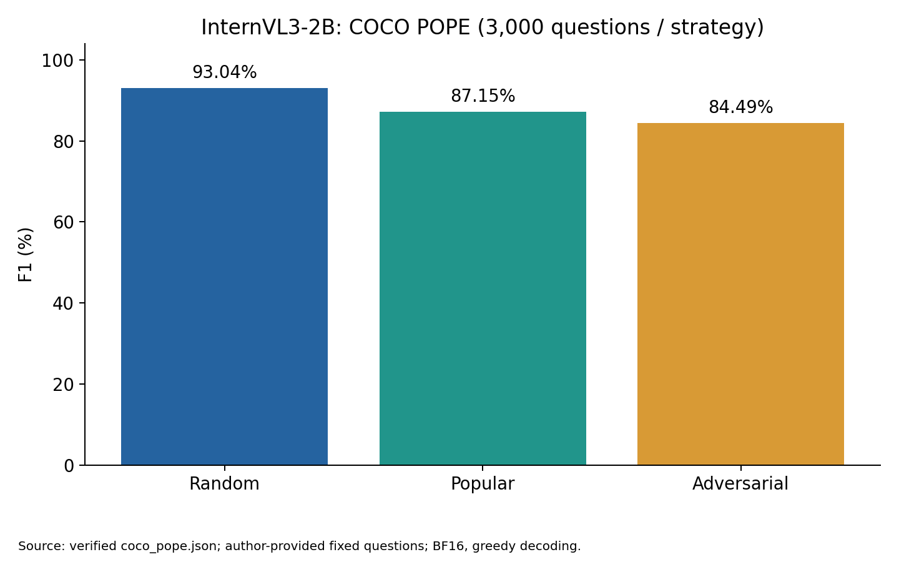
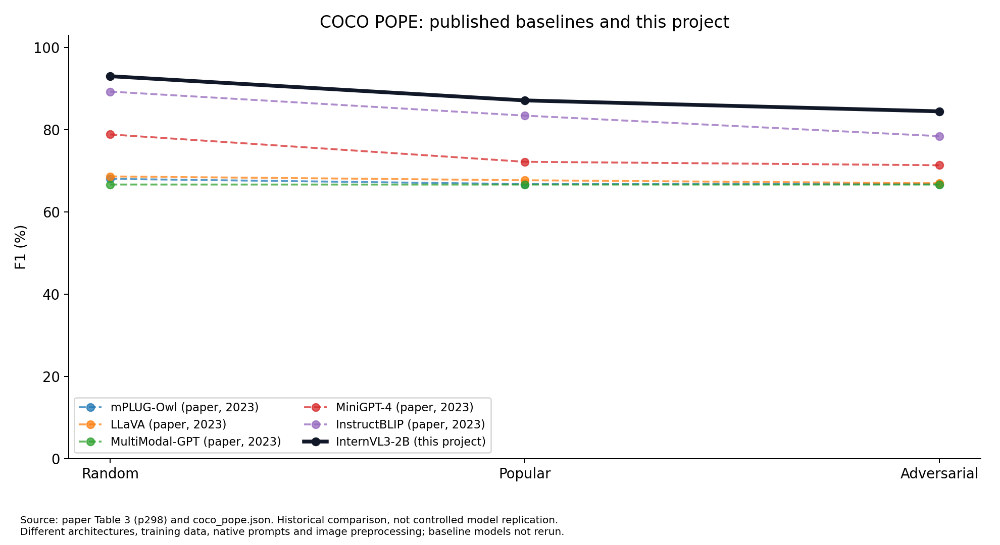

# POPE Reproduction and Extension with InternVL3-2B

[English](README_EN.md) · [教授版論文摘要](PAPER_SUMMARY_zh-TW.md) · [完整結果](EXPERIMENT_RESULTS_zh-TW.md) · [原文與本次差異](REPRODUCTION_COMPARISON_zh-TW.md) · [限制](LIMITATIONS_zh-TW.md)

VQA另附[方案D完整過程與A/B/C比較](VQA_D_PROCESS_AND_COMPARISON_zh-TW.md)：使用相同240題比較，保留失敗反例；D不是正式準確率。

## 專案簡介

這個專案想了解：AI 看圖片時，會不會認為圖片裡有實際不存在的物件？我們沿用 EMNLP 2023 [POPE 論文](https://aclanthology.org/2023.emnlp-main.20/)的評估方法，把受測模型換成 **OpenGVLab/InternVL3-2B**，保存實際回答並核對分數。

**這是新模型的評估與方法延伸，並非完整重新訓練或重跑原論文所有模型。** 原始結果留在本機；公開版提供研究程式、可追溯的彙整表、圖表及限制，不含影像、權重與未確認可再散布的逐題資料。

## 原論文摘要與研究目的

模型會利用文字裡常見的關係補出畫面，例如看到餐桌就回答有杯子。這類猜測有時合理，卻不符合圖片。作者先分析圖片描述中的物件幻覺，再提出 POPE：直接問「圖中有這個物件嗎？」。研究關心幻覺與物件常見程度、共現關係、提示寫法及其他視覺任務的關聯。四個重點及原 Table 1–12 的發現整理於[論文摘要](PAPER_SUMMARY_zh-TW.md)。

## 研究方法

COCO POPE 使用作者公開的固定 500 圖題集，每組 3,000 題、正負各半。Random 隨機選不存在物件；Popular 優先選常見但不存在的物件；Adversarial 優先選常與畫面物件共現、但本圖不存在的物件。以 Yes 為正類計算 Accuracy、Precision、Recall、F1 及 Yes Ratio。自由描述另以 CHAIRi/CHAIRs 評估，兩者越低越好。原始 Yes/No 解析規則照官方程式，沒有加上「只答 Yes/No」。

## 本次重現設定

| 項目 | 實際設定 |
| --- | --- |
| 模型 | InternVL3-2B，revision `899155015275a9b7338c7f4677e19c784e0e5a21` |
| 硬體 | NVIDIA RTX 3070 Ti，8GB；Windows |
| 環境 | Python 3.12.14、PyTorch 2.6.0+cu124、Transformers 4.52.1；專案獨立 `.venv` |
| 精度 | BF16、無量化；FP16 語言 logits NaN，**不是 OOM** |
| 生成 | batch 1、seed 0、greedy、beam 1、1024 token 上限、每題無歷史對話 |
| 影像 | 官方動態切圖，448px、max_num=12、thumbnail；最多 13 tiles |
| 來源 | POPE commit `08d957b917e5a378a2f99d35b6293c536a66298b` |

部分早期小上限輸出因已正常 EOS、圖片與提示一致而保留重用；不是每一列都重新以 1024 token 生成。截斷與重複描述保留在主要統計，並附敏感度分析。詳細條件見[重現說明](docs/REPRODUCIBILITY.md)。

## 實驗成果

| 策略 | 題數 | Accuracy % | Precision % | Recall % | F1 % | Yes % |
| --- | --- | --- | --- | --- | --- | --- |
| random | 3000 | 93.0333 | 92.9474 | 93.1333 | 93.0403 | 50.1000 |
| popular | 3000 | 86.2667 | 81.8875 | 93.1333 | 87.1491 | 56.8667 |
| adversarial | 3000 | 82.9000 | 77.3105 | 93.1333 | 84.4875 | 60.2333 |



CHAIR 原 2,000 圖：I1 CHAIRi **2.8634%**／CHAIRs **4.9500%**；I2 **4.7814%**／**18.0000%**。四提示 POPE F1 平均 **91.9855%**、母體標準差 **0.9340 百分點**。作者 SEEM 衍生固定題 A-OKVQA/GQA 各 9,000 題亦完成，見[完整結果與圖表](EXPERIMENT_RESULTS_zh-TW.md)。

## 與原論文的比較



InternVL3-2B 的 COCO POPE 三組 F1 高於原文 InstructBLIP 的 89.29/83.45/78.45%；但 CHAIR 的 I1/I2 比該模型的原文數值差。模型年代、架構、訓練資料及原生影像／對話處理不同，這是歷史對照，**不是控制所有條件後的模型優劣實驗**。完整差異見[逐項比較表](REPRODUCTION_COMPARISON_zh-TW.md)。

## 未完成的實驗與限制

- **Table 5：未完整重現。** 原 COCO SEEM 固定題無法取得並核對；沒有自行重抽題集冒充原測試。
- **Table 6／Appendix E：未重現原評判。** VQA 11,216 筆回答已保存，但沒有原 ChatGPT-assisted grader。本地 A/B/C 是補充診斷：A-OKVQA 0/1.0204/9.7959%，GQA 0/0.7196/36.3798%。不能把這些分數解讀為原文 VQA 語意準確率。
- **方案 D 不可採為正式準確率。** 僅固定 240 題的探索性符號規則；凍結後 17 個挑戰案例有 5 次錯誤接受，沒有獨立人工真值，也未執行開源文字模型評判。
- HRA/HRC 排序資料、零幻覺分母及 Captioning 提示等存在差異；單一模型不能驗證原文跨模型相關性。詳見[研究限制](LIMITATIONS_zh-TW.md)。

## 專案安裝與執行

不需要為閱讀結果下載模型。先看 `public_data/`，可在現有 Python 3.12 的獨立 venv 中執行純 CPU 公開資料查核：

```powershell
python -m venv .venv
.venv\Scripts\python.exe release_tools/check_public.py
```

重新繪圖需依賴套件；重新推論另需自行依法取得資料、固定版本模型及第三方評分程式。完整安裝、資料路徑、逐項執行與離線重算方式見[重現說明](docs/REPRODUCIBILITY.md)。**本次整理沒有重跑 GPU 推論，也沒有改動原始正式結果。**

## 專案檔案結構

```text
README.md / README_EN.md           閱讀入口
PAPER_SUMMARY_zh-TW.md             原論文四重點＋本次結果
REPRODUCTION_COMPARISON_zh-TW.md   比較條件與未重現項目
EXPERIMENT_RESULTS_zh-TW.md        實測數據、分母、圖表
LIMITATIONS_zh-TW.md              研究限制
GITHUB_RELEASE_AUDIT.md           公開前查核
scripts/                         原研究程式（不含本機盤點工具）
research_extensions/             VQA 補充規則及評分程式
release_tools/                   唯讀核對、圖表、公開版檢查
public_data/                     彙整 JSON/CSV、來源雜湊與設定
figures/                         自動生成 PNG/SVG
docs/                            重現與授權說明
```

本機另保留 `results/`、`analysis/`、舊技術報告及備份，未納入公開 Git。公開版的彙整查核不等於讀者已取得原始逐題資料，資料取得限制詳見[資料政策](docs/DATA_POLICY.md)。

## 參考文獻與授權

- Li et al. (2023), [POPE，EMNLP，292–305](https://aclanthology.org/2023.emnlp-main.20/)，[官方程式](https://github.com/RUCAIBox/POPE)。
- [InternVL3-2B 固定版本](https://huggingface.co/OpenGVLab/InternVL3-2B/tree/899155015275a9b7338c7f4677e19c784e0e5a21)。
- [CHAIR](https://github.com/LisaAnne/Hallucination)、[COCO Caption 評分](https://github.com/tylin/coco-caption)、[A-OKVQA](https://github.com/allenai/aokvqa)、[GQA](https://cs.stanford.edu/people/dorarad/gqa/)。

本專案原創程式與整理文字採 [MIT](LICENSE)，第三方權利不在此授權範圍；見[來源與授權說明](THIRD_PARTY_NOTICES.md)。本專案不是原作者官方實作或模型官方評測。
